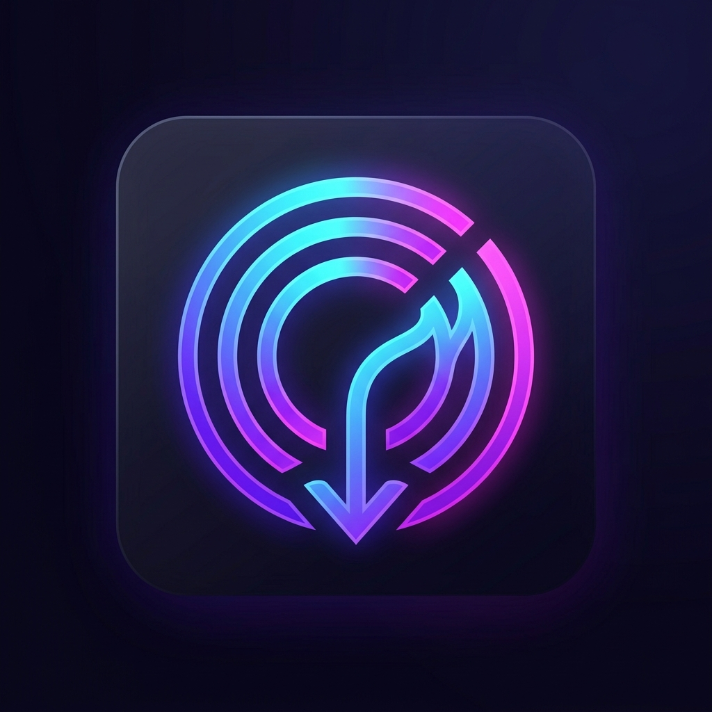

<div align="center">
  
  <h1>OmniStream Pro</h1>
  <p><strong>High-performance universal desktop video & audio extractor powered by yt-dlp, FFmpeg, and Electron.</strong></p>
  <p>
    <a href="https://omnistream-gamma.vercel.app" target="_blank">
      
    </a>
  </p>
</div>

---

## ✨ Features

- 💎 **Full High-Definition & 4K Downloads**: Unlocked 1080p Full HD, 720p HD, 480p, 360p, and MP3 audio downloads.
- ⚡ **Automated Bot Challenge Bypass**: Integrated with `web_embedded` and mobile extraction endpoints to bypass YouTube 429 and "Sign in to confirm you're not a bot" barriers without requiring cookies.
- 📋 **Single Video & Batch Queue**: Download individual videos or paste dozens of links at once with queue status indicators.
- 🎨 **Modern Cyber-Luxe UI**: Built with Obsidian dark theme, glassmorphic cards, luminous ambient glow, and high-contrast Light mode.
- 🚀 **Real-Time Telemetry HUD**: Live download speed (MB/s), countdown ETA, progress shimmer bar, pause/resume, and cancel controls.
- 📂 **Instant Library Archive**: Keeps track of recent downloads with direct "Show in File Explorer" and copy link actions.
- 📺 **1,000+ Platforms Supported**: YouTube, TikTok, Instagram Reels, X (Twitter), Vimeo, Reddit, Twitch, and more.
- 🛠️ **Live Activity Terminal**: Real-time streaming console drawer for extractor logs and ffmpeg operations.

---

## 🛠️ Prerequisites

- **Node.js**: v18.0.0 or higher
- **yt-dlp**: Installed and available via Python (`py -m pip install -U yt-dlp`) or PATH
- **ffmpeg**: Available on PATH (for combining separate video/audio streams and MP3 conversions)

---

## 🚀 Getting Started

### 1. Clone the repository
```bash
git clone https://github.com/ArfaaTaj-savas/OmniStream.git
cd OmniStream
```

### 2. Install dependencies
```bash
npm install
```

### 3. Start the application
```bash
npm start
```

### 4. Build desktop installers
```bash
npm run dist
```
Generates a standalone Windows installer (`.exe`) in the `dist/` directory.

---

## ⚖️ Legal & Compliance Disclaimer

OmniStream is intended exclusively for saving content you have the legal right or explicit permission to download (e.g. personal backups, public domain, Creative Commons, educational use). It does not bypass DRM, encryption, or paywalls. Please respect platform terms of service and creators' copyright.

---

## 📄 License

MIT License © 2026 MD ARFAA TAJ (SAVAS)
